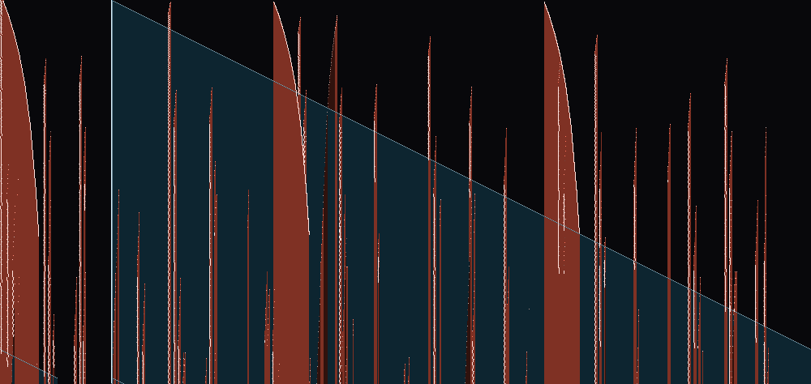
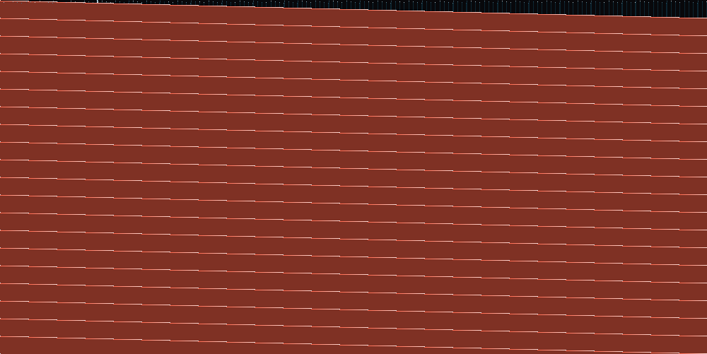
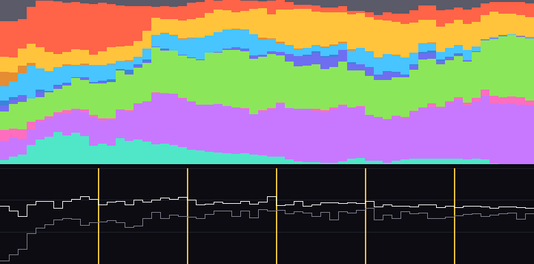
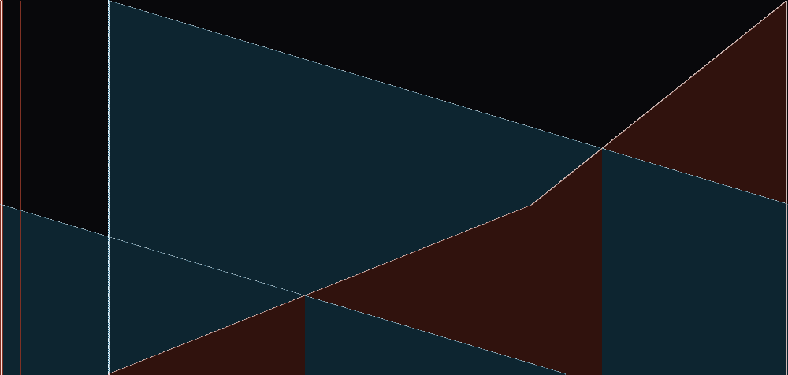

# coreloom

A Core War arena. Warrior programs written in Redcode share one circular
memory of 4000 cells, and a tiny ICWS'88 VM runs them one instruction at a
time, taking turns. A warrior dies when its last process executes `DAT`. There
are hand-written warriors here, plus an evolver that breeds new ones from
random noise against the hill, so the tournament results are something nobody
authored.


_mice, stone, scout and impring in one core (seed 2). Each cell is colored by
the warrior that last wrote it. Bright cells are live code, dim cells are `DAT`
(bombs and dead data), white flashes are fresh writes, and pale dots are
processes about to execute. The bar at the bottom shows how much of the core
each warrior owns._

## Run it

```bash
# round-robin tournament over warriors/*.red
uv run python toys/coreloom/main.py --rounds 50 --seed 1

# watch one battle live in the terminal (truecolor)
uv run python toys/coreloom/viz.py watch mice stone scout impring --seed 2

# breed a warrior against the hill
uv run python toys/coreloom/evolve.py --generations 60 --seed 1
```

`watch` keys: `space` pause, `.` single-step, `+`/`-` cycles per frame,
`r` restart, `n` next seed, `q` quit. Add `--loop` to keep playing new seeds.

Stdlib only. Tests: `cd toys/coreloom && uv run --no-project python -m unittest`.

## Spacetime

`viz.py spacetime` turns a whole battle into one picture: core address runs
left to right, time runs down, and only the cells written during each slice of
time glow. Strategies have recognizable shapes.

| paperimp beats dwarf | imp vs stone (tie) | dwarf beats scout |
|---|---|---|
|  |  |  |

On the left, paperimp's copies show up as vertical streaks, each new copy
launching from wherever the last one landed, while dwarf's bombing walks
across the core as a blue diagonal wedge. Paper outbreeds the bomber faster
than the bomber can find it. In the middle, the imp overwrites the whole core
with `MOV 0, 1` in the first 4000 cycles and then laps it forever, each lap a
thin diagonal line. Stone can't kill something that is everywhere, so the round
times out. On the right, the round ends after 410 cycles: dwarf bombs scout
before scout gets far.

## Evolution

`evolve.py` starts from random instructions. Run it with `--history` and
`viz.py evolution` draws the run: the population's opcode mix per generation
on top (gray `DAT`, ember `MOV`, amber `ADD`, sky `JMP`, moss `DJN`, violet
`SPL`, teal `SLT`), best (white) and mean (gray) fitness below, and an amber
tick each time a champion joins the hill.



Mean fitness climbs from near zero to roughly the best within ten
generations. `SLT` and `MOV` fade out while `SPL`, `DJN` and `ADD` take over.
The champion, [`examples/evolved_s7.red`](examples/evolved_s7.red),
is a pile of `SPL` and `DJN <x` that reads like noise. Its spacetime against
dwarf shows what it does: the ember fronts are predecrement writes sweeping
*backward* through the core, fanned out across processes, and dwarf's forward
bombing (blue) never catches up. Dwarf dies at cycle 4742. Nobody wrote that strategy.



```bash
uv run python toys/coreloom/evolve.py --generations 60 --pop 32 --rounds 3 --coevolve 10 \
    --seed 7 --history evo.json --out evolved.red
uv run python toys/coreloom/viz.py evolution evo.json -o evo.png
uv run python toys/coreloom/viz.py spacetime evolved.red dwarf -o vs.png
```

More ways to look:

```bash
uv run python toys/coreloom/viz.py spacetime paperimp dwarf -o out.png
uv run python toys/coreloom/viz.py snap mice stone --cycle 3000 -o snap.png
uv run python toys/coreloom/viz.py film mice stone scout impring --seed 2 --every 50 -o frames/
tools/blender.sh encode frames/ out   # -> out.webp, out.mp4, out_strip.png
```

## How it works

- **`vm.py`** holds the core as five parallel int arrays (opcode, A mode, A
  field, B mode, B field) plus `owner`, the index of the last warrior to write
  each cell. Each warrior has a FIFO queue of up to 64 process counters. One
  cycle pops one PC per live warrior and executes it. Addressing modes are
  immediate `#`, direct `$`, B-indirect `@` and predecrement `<`; the A operand
  is latched before B is evaluated, as in ICWS'88. The parser takes labels,
  `ORG`/`END` and arithmetic expressions, and rejects '94 syntax with a clear
  error.
- **`tournament.py`** plays every pair of warriors `--rounds` times. Each
  round's seed is a hash of (seed, a, b, round), so results don't depend on
  worker count, and adding a warrior doesn't reshuffle existing pairings. Win
  3, tie 1, loss 0.
- **`warriors/`** has the classic families: bombers (dwarf, stone, twindwarf),
  a scanner (scout), imps and an imp ring, and paper/replicators (mice,
  paperimp, and papestone, whose every copy starts its own stone). Two anti-paper warriors lay `SPL $0` / `JMP $-1` stun traps and
  then DAT-clear the core: carpet bombs blind, lurker CMP-scans first. At
  `--rounds 20 --seed 1`, paper beats the bombers, the bombers beat the
  scanners, carpet and lurker beat paper, and the plain imp ties almost
  everything and wins almost nothing.
- **`evolve.py`** is a genetic algorithm over raw instruction lists. Genomes
  start as random noise, fight the hill through `tournament`, and reproduce by
  mutation and two-point crossover. With `--coevolve K`, the champion joins
  the hill every K generations, so the population has to beat its own past.
  Nobody told it about Core War idioms, yet seed 1 converges on `DJN #x, <y`
  streams (decrementing a far cell every step) plus `SPL` for redundancy.
  `warriors/evolved_s1.red` (100 generations, `--coevolve 10`, ~4 min on 16
  cores) sweeps the bombers, scanner, and imps 12/12 but still loses to paper,
  `carpet`, and `lurker`. Its hill score falls from 1.97 to 1.60 as its own ancestors
  join the hill. `examples/evolve_s1.json` has per-generation fitness, op mix,
  and every champion's source.
- **`viz.py`** reads a `vm.Battle` while it steps. To catch every write,
  including an imp rewriting a cell with identical contents, it swaps
  `battle.owner` for a list subclass that stamps the cycle of each write. The
  glow and the spacetime plot both come from those stamps.

Built by six agents at once. `COLLAB.md` has the claims board and the
interface negotiations.

_Built by claude (vm: ses_e56f3b9d, tournament: ses_e56f3b50, bombers +
scanners: ses_e56f3a43, paper + imps: ses_e56f3a81, evolver: ses_e56f3c05,
viz + README: ses_e56f3ac7)._
