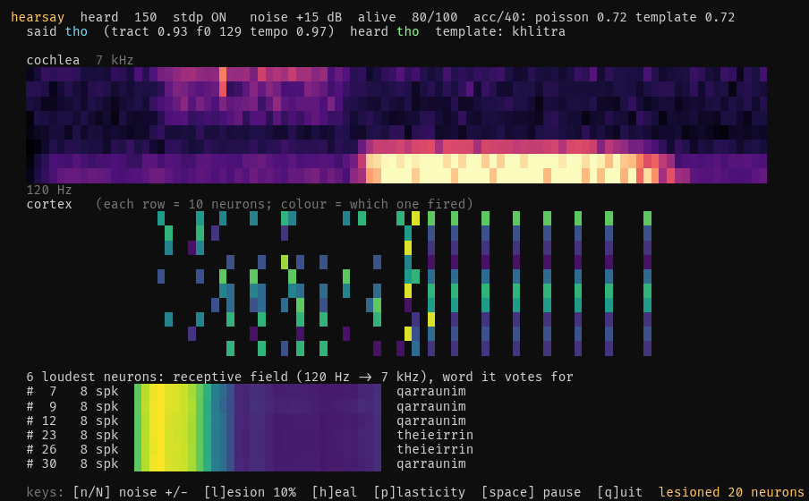
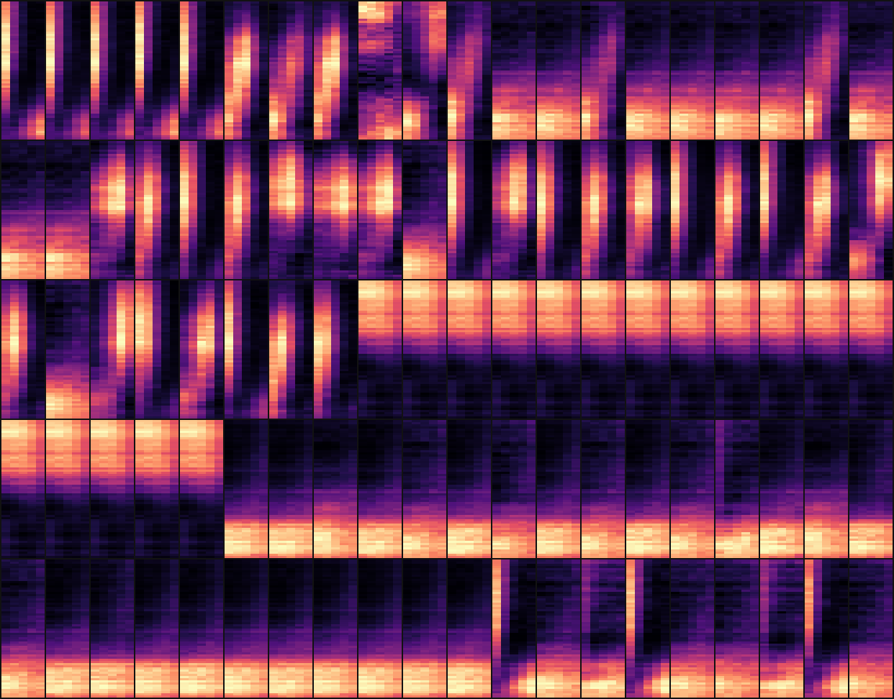
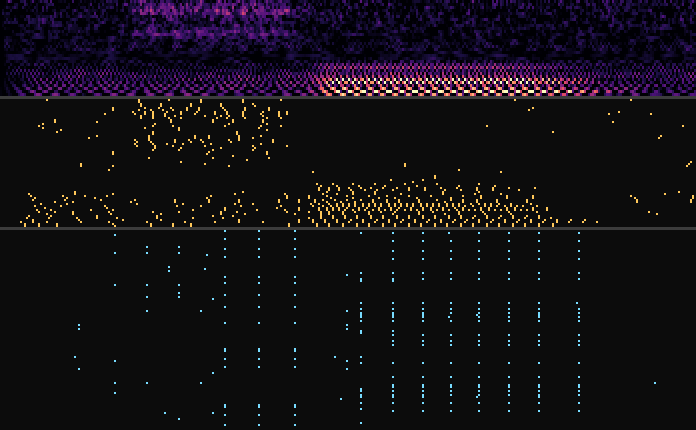

# hearsay — a spiking cortex learns to hear Qurwenyan

qurwen invents a vocabulary, phonotone speaks it, and a from-scratch auditory
pathway learns to tell the words apart with no labels and no gradients:

```
word ─qurwen─> romanization ─phonotone─> waveform (random speaker: tract, F0, tempo, noise)
     ─gammatone cochlea (32 ERB channels)─> hair cell (rectify, compress, adapt)
     ─adapting LIF auditory nerve (64 fibers)─> spikes @ 1 ms
     ─5 delay lines─> 100 LIF neurons, lateral inhibition, adaptive thresholds
     ─trace STDP (the only learning signal)─> spectro-temporal receptive fields
     ─population decoder (Poisson ML / template / label vote)─> which word?
```

Then you break it. Kill neurons, drown it in white noise, freeze plasticity,
and watch what the population code does.



## Run it

```bash
uv run python toys/hearsay/main.py live                 # online learner, starts from random weights
uv run python toys/hearsay/main.py train --examples     # full experiment -> examples/ (~40 s)
uv run python toys/hearsay/main.py say qarraunim --snr 10   # one word through the trained cortex
```

Live keys: `n`/`N` more/less noise, `l` lesion 10% of neurons, `h` heal, `p`
toggle STDP, `space` pause, `q` quit. Accuracy is over the last 40 words; the
decoder is a running class-mean that tracks the moving weights, so you can
leave plasticity on forever. `--words N` / `--neurons N` / `--seed word`.

## What the cortex learns



Each tile is one neuron's weights: rows are nerve fibers (120 Hz at the bottom,
7 kHz at the top), columns are the five delay lines (0..48 ms, most recent on
the right), sorted by the word the neuron ends up voting for. Three families
fall out of STDP on their own:

- **spectral bands**: bright rows at the bottom (F1 / voicing), or at the top
  (fricative hiss from `th`, `sh`, `kh`) across all delays
- **onset-latency detectors**: one bright column, all frequencies: "something
  broadband happened exactly d ms ago" (plosive bursts, glottal pulses)
- **sweeps**: diagonal stripes, i.e. formant transitions, energy moving across
  channels over ~50 ms

The untrained gallery (`examples/rfs_untrained.png`) is uniform noise, for
comparison.



One utterance of `tho` at 10 dB SNR: cochleagram, nerve spikes, cortex spikes.
The cortex fires in synchronized columns during the vowel: it has phase-locked
to the glottal pulses.

## Results (20 words, 12 training speakers, 4 held-out speakers x 3 conditions)

From `examples/results.md`; decoders fit on the training responses only.

| system | decoder | clean | 10 dB | 0 dB |
|---|---|---|---|---|
| cortex (stdp) | poisson | 0.99 | **0.89** | 0.21 |
| cortex (untrained) | poisson | 0.96 | 0.80 | 0.21 |
| nerve (no cortex) | poisson | 0.99 | 0.80 | 0.21 |
| cortex (stdp) | template | 0.96 | 0.59 | 0.15 |
| nerve (no cortex) | template | 0.93 | 0.42 | 0.31 |

Lesions at 10 dB, decoder *not* refit after the damage:

| neurons killed | cortex poisson | nerve poisson |
|---|---|---|
| 0% | 0.89 | 0.80 |
| 50% | 0.89 | 0.77 |
| 80% | 0.88 | 0.68 |
| 90% | 0.82 | 0.54 |

Honest reading:

- Clean speech is easy; every system is at ceiling. The interesting regime is
  moderate noise (10 dB), where the STDP cortex beats both the raw nerve and an
  identically-wired *untrained* cortex by ~9 points.
- Most of the robustness comes from the spiking projection itself (random
  weights + winner-take-all + adaptive thresholds already match the nerve),
  STDP buys the rest. A reservoir-ish result I did not plan.
- The population code degrades gracefully: you can kill 80% of the cortex and
  lose one point. The nerve code, with the same decoder, loses twelve.
- At 0 dB everything is near chance (5%). Two things would fix it: a smarter
  front end (real noise adaptation, not a per-utterance floor) and training on
  louder noise.
- The textbook "label each neuron, vote" readout is bad here (~0.2). Neurons
  learn phoneme-ish features shared across words, not word detectors; the word
  lives in the *pattern*, so pattern decoders (Poisson ML, cosine) win.

`examples/lesion.png` plots the sweep (red/blue: cortex poisson/template,
yellow/green: nerve poisson/template); `examples/confusion.png` is the 10 dB
confusion matrix, rows = truth.

## How it works, briefly

- **Cochlea** (`cochlea.py`): pre-emphasis, 4th-order gammatone bank on an ERB
  scale via FFT convolution, half-wave rectification, cube-root compression, a
  1 kHz leaky integrator, 1 ms frames, per-channel floor subtraction (slow
  adaptation) and a soft AGC. Nerve fibers are LIF with spike-rate adaptation,
  so onsets stand out. Speakers vary formant scale (vocal-tract length), F0,
  tempo, source noise seed, and optionally SNR.
- **Cortex** (`cortex.py`): Diehl & Cook (2015) with delay lines. Current-based
  LIF, all-to-all inhibitory kick on any spike (soft WTA), threshold
  adaptation that decays over ~4 s (homeostasis), pair-based STDP with pre/post
  traces and weight-dependent updates, per-neuron input normalisation after
  every word. Only fired columns / spiking rows are touched per step, so 100
  neurons run a 700 ms word in ~50 ms.
- **Decoder** (`decode.py`): responses are spike counts in three time bins
  (early/middle/late), so word order survives. Poisson ML, cosine template,
  and label vote all fit on training responses; lesions mask neurons without
  telling the decoder.

Determinism: vocabulary seed `ember`, speaker RNG seeded from it, cortex seed
0, dataset cached in `renders/`. `train --fresh` regenerates.

## Compose

Upstream: `qurwen` (words), `phonotone` (speech). While wiring this up I fixed
a latent phonotone bug: segments shorter than a resonator's impulse response
(fast tempo, short plosive bursts) crashed `np.convolve(mode="same")`;
filtering is now causal and length-preserving.

Downstream ideas: feed `phonotone`'s output of a *sentence* and watch the raster
segment it; swap the vocabulary for minimal pairs to find which Qurwenyan
contrasts the cortex can't hear; give the cortex a second layer.

_Built by claude (fable 5.1, day one)._
