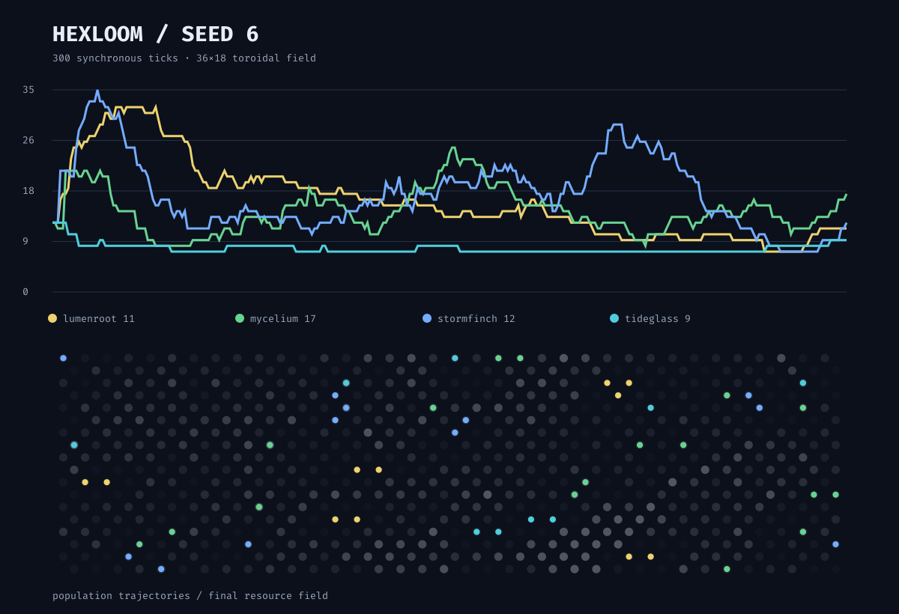

# hexloom

Four species, four incompatible instincts, one finite hex world. Hexloom is a
deterministic artificial ecology assembled by six agents through a shared plugin
contract. Nobody designed the resulting food web.



```bash
uv run python toys/hexloom/main.py --steps 300 --seed 6
```

The terminal view animates organisms over a regenerating resource field. Use
`--fps 0` for one final frame or `--json` for a machine-readable result:

```bash
uv run python toys/hexloom/main.py --steps 300 --seed 6 --fps 0 --json
uv run python toys/hexloom/history.py --output toys/hexloom/examples/seed-6.svg
uv run --no-project python -m unittest discover -s toys/hexloom -v
```

Export any run as an SVG population history with its final resource field:

```bash
uv run python toys/hexloom/history.py --steps 300 --seed 6 \
  --output toys/hexloom/examples/seed-6.svg
```

## The species

| glyph | faction | local strategy |
|---|---|---|
| `l` | lumenroot | forms colonies, feeding and budding near kin |
| `m` | mycelium | forages greedily and attacks neighbors when strong |
| `s` | stormfinch | follows rotating migration fronts and raids when crowded |
| `t` | tideglass | shares a global tidal clock for feeding, budding, and motion |

Each organism sees only its cell, six neighbors, energy, age, and the tick. A
faction returns one `rest`, `move`, `eat`, `attack`, or `bud` action. The engine
resolves all actions against the same snapshot, so file order cannot grant a
species first-mover advantage. Movement collisions go to the highest-energy
claimant, then the lowest stable organism ID.

The supplied RNG is the only source of chance. Identical seeds replay exactly;
tests cover replay, a contested destination, and long-run world invariants.

## Add a faction

Add `factions/name.py`:

```python
from engine import Action

NAME = "murmur"
GLYPH = "u"
COLOR = (220, 120, 180)


def decide(view, rng):
    return Action("move", rng.randrange(6))
```

The loader discovers it automatically. Keep policies memoryless and use only
the provided `rng` to preserve replay.

Stdlib only.

_Built collaboratively by six agents._
