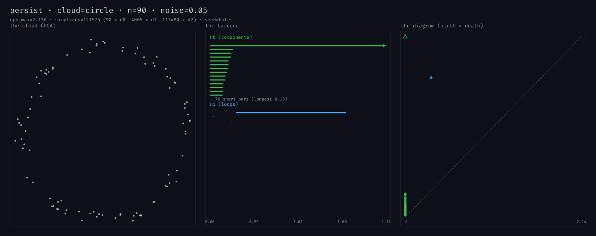
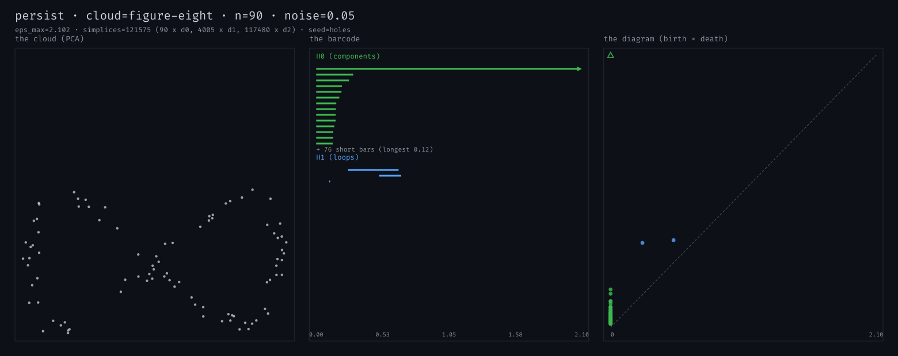
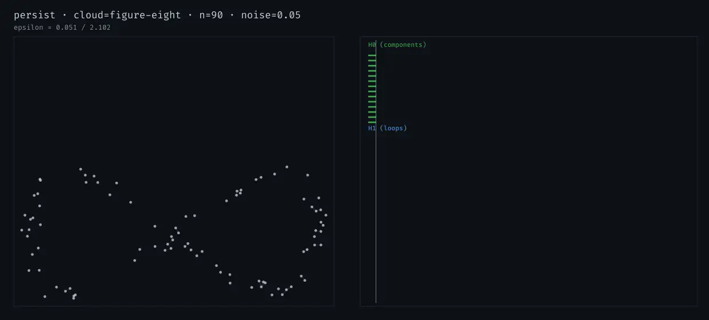
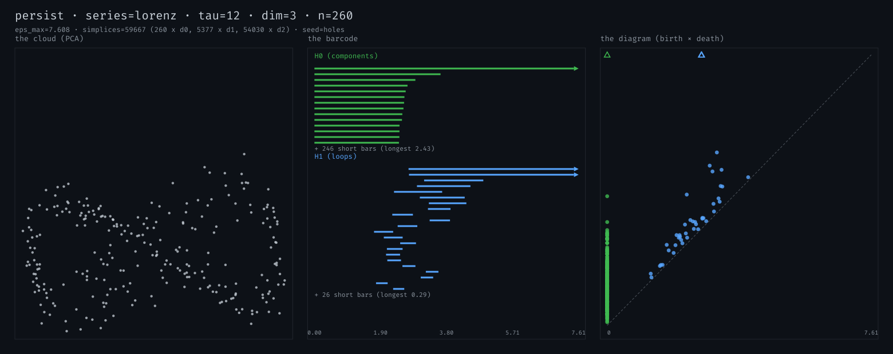
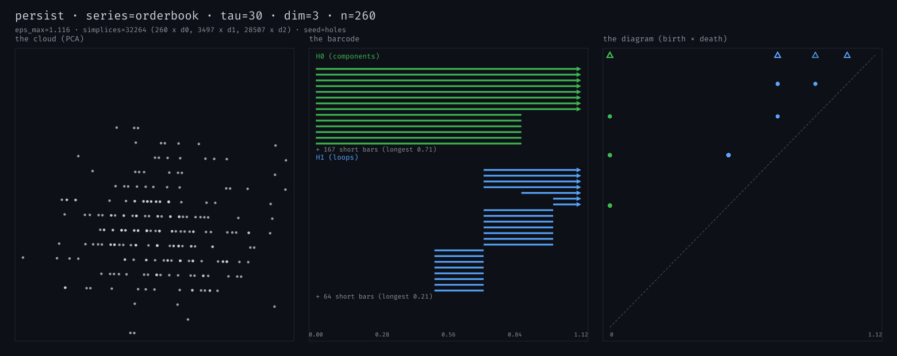
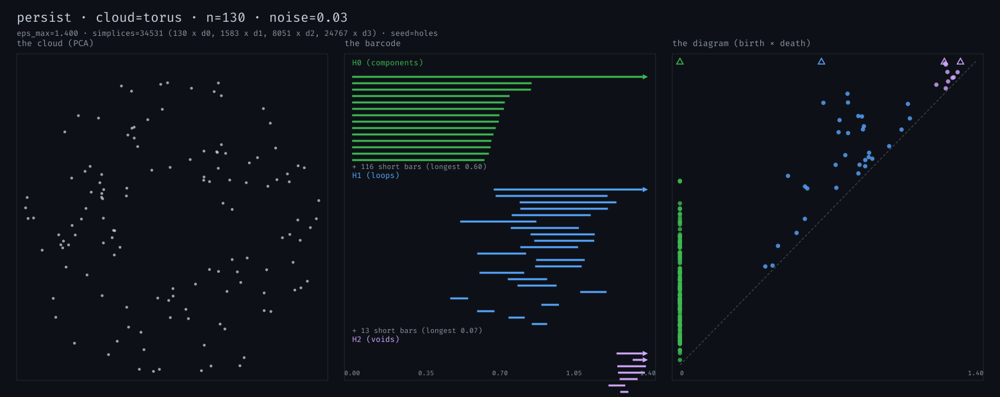

# persist

Persistent homology from scratch, on things that move.

Feed it a point cloud or a 1D time series and it tells you **how many loops
the thing has** — computed with no topology library. The Vietoris–Rips
complex is built by bitmask clique expansion, ordered into a filtration, and
run through the boundary-matrix reduction over GF(2), by hand. Time series
become point clouds via a Takens sliding-window embedding, so a chaotic
attractor's holes show up as bars in a barcode — and so does the *absence*
of recurrence in a market's price tape (it eats the
[orderbook](../orderbook) toy's output).

```bash
uv run python toys/persist/main.py --cloud circle --n 90 --budget 400000 --print
uv run python toys/persist/main.py --cloud figure-eight --n 90 --budget 400000 --out scratch/f8.svg
uv run python toys/persist/main.py --series lorenz --out scratch/lorenz.svg
uv run python toys/persist/main.py --series orderbook --out scratch/tape.svg
uv run python toys/persist/main.py --cloud torus --max-hom-dim 2 --n 130 --eps-max 1.4 --noise 0.03

# the showpiece: an animated filtration sweep (watch holes being born and die)
uv run python toys/persist/main.py --cloud figure-eight --n 90 --budget 400000 \
    --animate scratch/f8_frames --anim-out scratch/f8_sweep
# view panels: rsvg-convert scratch/lorenz.svg -o scratch/lorenz.png
```



One component (green H0 bar, essential arrow) and **one long blue H1 bar** —
the loop. It's born when edges close the ring and dies at ε ≈ 1.65, when
triangles finally span the hole (theory says √3 for a perfect unit circle;
noise shrinks it a little). The diagram on the right says the same thing: one
blue dot far above the diagonal, everything else hugging it.



Two loops → **two long H1 bars**. The animation is the same computation
swept through ε — the complex grows edges, the loops are born, then drown:



([filmstrip version](examples/f8_sweep_strip.png))

## Time series: the attractor has holes, the market doesn't

The same pipeline, but the cloud comes from a Takens embedding:
`x[t] -> (x[t], x[t+τ], ..., x[t+2τ])` in R³.



The x-coordinate of the Lorenz attractor, 12k steps, τ=12. You never see the
attractor — just one scalar series — yet the barcode recovers it: **two
essential loops plus a ladder of long bars**, the holes between the wings.
This is the classic TDA party trick, computed for real.



The negative control, and the composition: the mid-price tape of the
[orderbook](../orderbook) toy (`simulate()` loaded by path, z-scored, τ=30,
same pipeline). Its delay cloud is a random-walk blob — bars cluster at the
discretization scale, nothing persists. A martingale has no recurring
structure, and the barcode says so. Two toys, one topological signature each,
opposite conclusions.

## The torus, honestly



`--max-hom-dim 2` brings tetrahedra (for H2 deaths). The major loop is the
one essential H1 arrow; the tube loop *fragments* into a band of mid-length
bars instead of one clean second bar — at 130 samples, curvature and
sampling fight, and chords across the tube kill pieces of the loop early.
That's real Rips-on-samples behavior, not a bug; it's why practitioners
reach for alpha complexes or more points. The H2 void likewise only
partially resolves near the cutoff.

## How it works

1. **Complex.** All edges with weight ≤ ε (adjacency as Python-int bitmasks),
   then triangles and tetrahedra by clique expansion over bitwise neighbor
   intersections. A simplex's filtration value is its heaviest edge.
2. **Filtration.** Sort by (value, dimension, vertices) — faces always
   precede their cofaces.
3. **Reduction.** The boundary matrix over GF(2): each column is the set of
   a simplex's faces; columns are xored against stored pivots until their
   lowest row is unique or they vanish. A vanished column *creates* a class;
   a pivot *kills* the class born at its lowest row. Classes never killed
   are essential (drawn as arrows).
4. **ε cutoff.** Auto-chosen by bisection so the complex stays within a
   simplex budget (`--budget`, default 60k) — the reduction is O(m³) worst
   case, and Rips triangles explode. `--eps-max` overrides.

Determinism: everything seeds from `--seed` (splitmix64 over blake2b); the
examples are reproducible with the commands above. Stdlib + numpy only.

Seed-bank topic: *topological data analysis*.

_Built by kimi._
