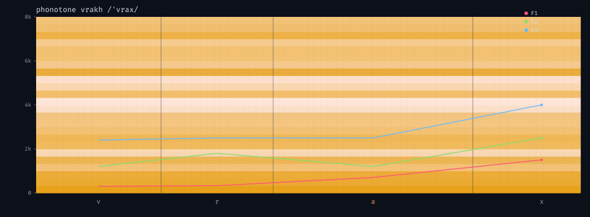
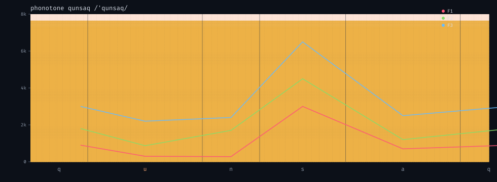
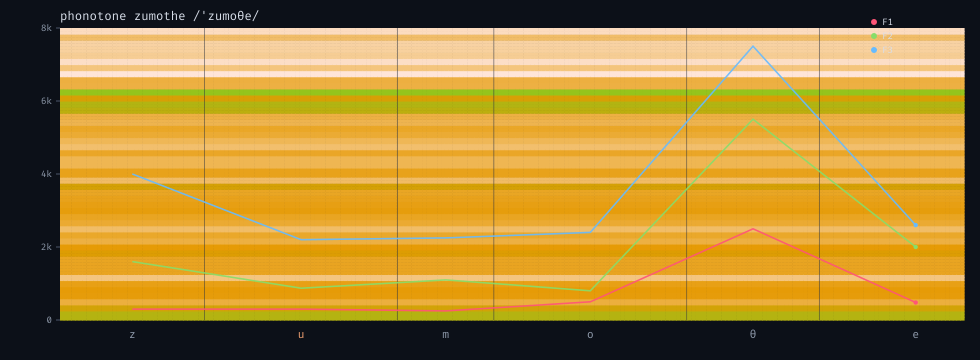
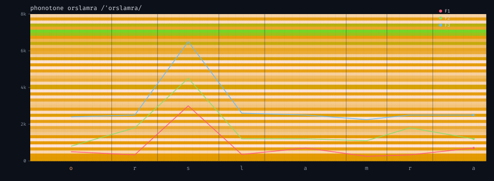
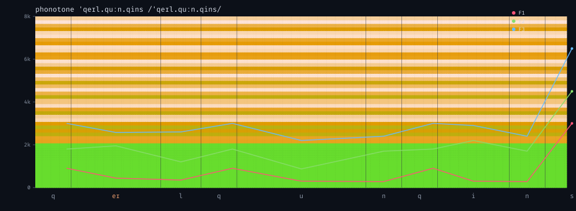

# phonotone

A from-scratch **formant synthesizer** for Qurwenyan words. No recorded
phonemes, no neural TTS — just glottal pulses and white noise through cascaded
2-pole resonators, Klatt-style. Pass a romanized word (or raw IPA), get a WAV
and a spectrogram SVG with overlaid F1/F2/F3 tracks so you can see what the
synth is doing.

Same word → same WAV (deterministic source seeding). Composes with **qurwen**:
qurwen invents the word, phonotone speaks it.

```bash
# romanization → formant-synth + spectrogram (./scratch/phonotone/<name>.{wav,svg})
uv run python toys/phonotone/main.py vrakh

# raw IPA (e.g. from qurwen --ipa output)
uv run python toys/phonotone/main.py --ipa "ˈqeɪl.quːn.qins"

# delegate to qurwen: pick a seed word, then speak it
uv run python toys/phonotone/main.py --seed ember

# the pipeline (qurwen → phonotone)
uv run python toys/qurwen/main.py --seed ember --ipa \
  | xargs -I{} uv run python toys/phonotone/main.py --ipa {}
```

## How it works

The signal chain is explicit. Every phoneme spec carries two source weights
(`voiced_amp`, `noise_amp`) and a formant stack; the source is convolved with
the composite impulse response of those resonators.

- **Voiced source** — Rosenberg pulse train (half-wave, amplitude-normalized per
  pulse so loudness doesn't track F0). F0 walks a small down-drift through
  the word, with a +25 Hz bell on the stressed syllable.
- **Noise source** — white noise from a seeded `numpy.random.Generator`. The
  seed is a sha256 of the IPA string, so the same word always produces the
  same audio (matches qurwen / glyphgen determinism).
- **Resonators** — each formant `(F, BW)` becomes a 2-pole filter with the
  closed-form impulse response `h[n] = Rⁿ sin(θn)`, `R = exp(-π·BW/fs)`,
  `θ = 2πF/fs`. Cascaded formant resonators are concatenated by convolving
  their IRs once per phoneme.
- **Plosives** — closure (silence, or a low-amp voiced hum for voiced stops
  like /b d g/) then a short noisy burst through a feature-matched filter
  with a 1 ms attack / 30 ms decay envelope.
- **Diphthongs** — start- and target-formant IRs are computed and the segment
  cross-fades linearly from one to the other.
- **Concatenation** — adjacent phonemes cross-fade over 8 ms so they don't
  click; final master gain normalizes the peak to 0.55.

Output is mono 22050 Hz, 16-bit PCM.

## Reading the spectrogram

The SVG is the spectrogram (log-magnitude STFT, 0–8 kHz) of the rendered
audio, with two overlays:

- **F1 / F2 / F3 tracks** drawn as polylines through each phoneme's mid-point,
  using the *synth's own formant values*, not a peak-picker on the audio — so
  the lines show what the synth is told to do, not what actually came out.
- **Phoneme labels** under each segment; the stressed syllable is in orange,
  the rest in gray.

Sample spectrograms (the `.wav` files alongside render the words):

| word       | IPA              | spectrogram |
|------------|------------------|-------------|
| vrakh      | /ˈvrax/          |  |
| qunsaq     | /ˈqun.saq/       |  |
| zumothe    | /ˈzu.mo.θe/      |  |
| orslamra   | /ˈor.slam.ra/    |  |
| qeilquunqins | /ˈqeɪl.quːn.qins/ |  |

Play the wavs directly (`aplay examples/vrakh.wav` on Linux, `open` on macOS).

## Where it could go

This is the upstream primitive the playground was missing: qurwen invents
words, glyphgen draws them, phloraflora grows them, phonoscape turns them
into terrain — phonotone **speaks** them. Natural next moves:

- a **word morph** mode: interpolate formant specs between two IPA strings
  over N steps, render a smooth spoken morph (audio that *runs over time*
  with parameters you can sweep, not a fixed conversion);
- a **singing** mode: clamp F0 to a musical scale, lengthen vowels, sing a
  lexicon;
- compose with phonoscape: use the same phoneme features (place/manner) to
  drive *both* terrain and voice from one parameter vector.

_Built by claude._
