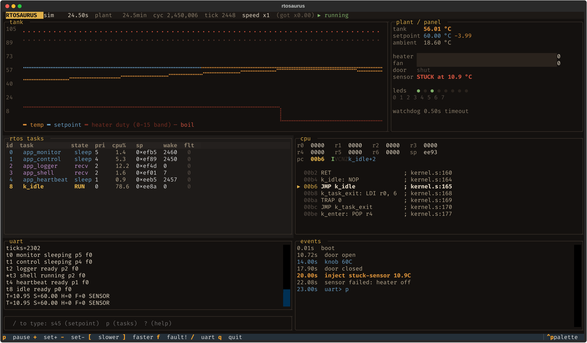
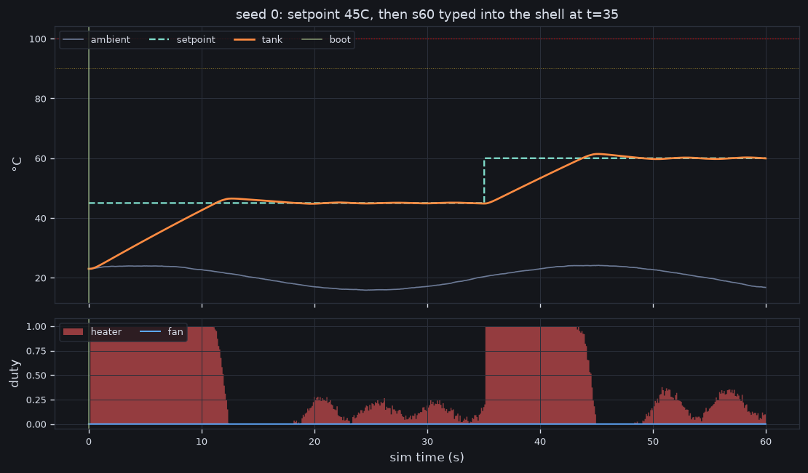
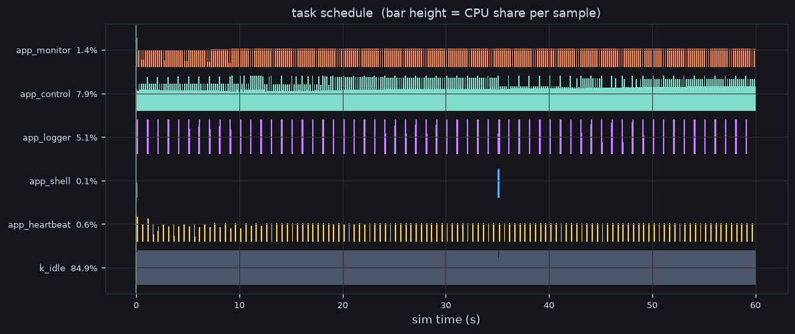
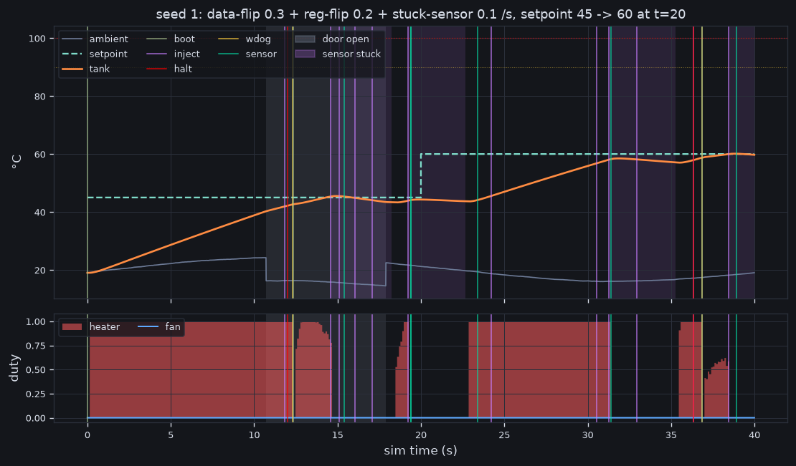
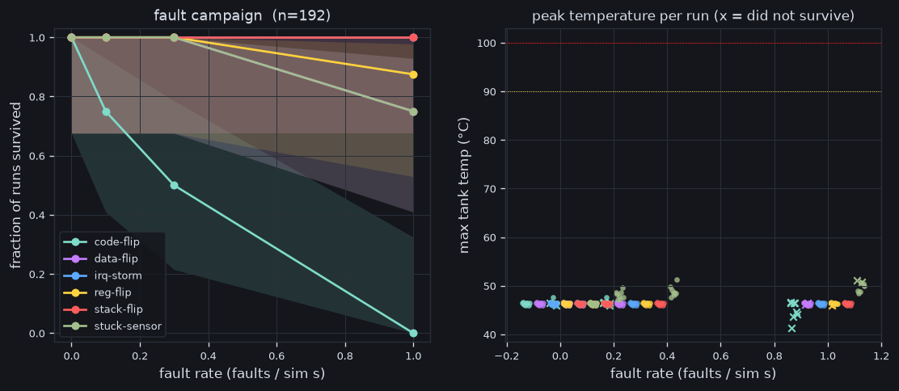
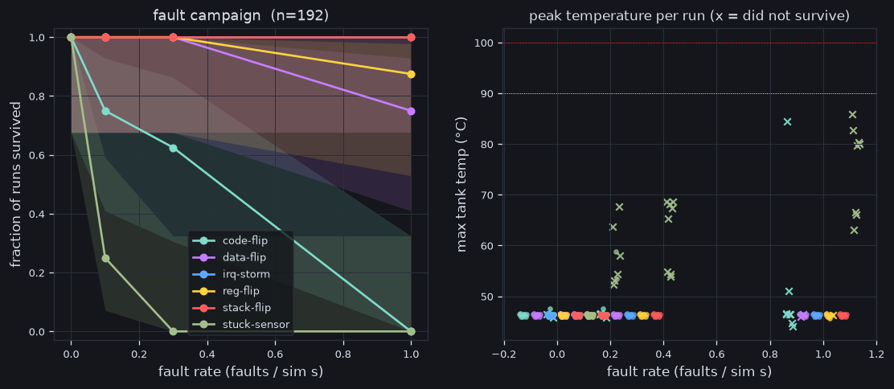

# rtosaurus

An emulated 16-bit microcontroller running a **preemptive RTOS written in its
own assembly language**, whose firmware keeps a simulated water tank at
temperature. Then you attack it: flip bits in its memory and registers, freeze
its temperature sensor, flood its UART. The kernel's fault isolation, the
watchdog, and the firmware's sensor sanity checks are what stand between the
tank and a boil.



```bash
uv run python -m rtosaurus dash                                  # live dashboard
uv run python -m rtosaurus run --seconds 60 --at 35:s60          # headless, stream UART
uv run python -m rtosaurus run --inject stuck-sensor:0.2 --plot run.png --gantt gantt.png
uv run python -m rtosaurus campaign --rates 0,0.25,1,4 --seeds 6 --plot campaign.png
uv run python -m rtosaurus campaign --kinds stuck-sensor --no-safety   # naive firmware
uv run python -m rtosaurus asm --listing                         # assembled firmware
uv run pytest toys/rtosaurus
```

Dashboard keys: `+`/`-` setpoint, `/` type into the UART (`s45`, `p`, `?`),
`f` inject a random fault (`1`-`6` for a specific kind), `z x c v` buttons,
`[ ]` speed, `p` pause, `q` quit.

## What's in the box

Every layer is real and runs every instruction; nothing is faked by Python.

| layer | what it does |
|---|---|
| **T16 ISA** (`isa.py`) | 41 two-word instructions, 8 registers, Z/N/C/V/I flags, Q8.8 fixed-point multiply, vectored interrupts, precise faults. Memory-mapped I/O at `0xFF00`. |
| **CPU** (`cpu.py`) | Decode/execute with cycle costs, IRQ/TRAP/fault entry, double-fault halt, a non-maskable watchdog. Instructions are compiled and cached per address, with invalidation when memory changes (so bit flips in code take effect). About 1.5M simulated cycles/s. |
| **Assembler** (`asm.py`, `disasm.py`) | Two-pass, with expressions, `.include`, `.equ`, `.string`, and a source-line map. The disassembler round-trips. |
| **Bus + peripherals** (`bus.py`) | 64K words of RAM, a 100 Hz timer, UART with level-triggered rx IRQ, GPIO LEDs/buttons, ADC (Q8.8 °C), PWM heater/fan, watchdog. |
| **Plant** (`plant.py`) | A 20 L tank with heater element lag, losses to a day/night ambient, a fan, a door that randomly opens, and sensor noise. Physics runs 60x faster than sim time. |
| **Kernel** (`firmware/kernel.s`) | Preemptive priority scheduler with round-robin among equals, sleep, 8 message queues, syscalls via `TRAP`. A faulting task is killed and the rest keep running. Watchdog bite restarts the firmware. |
| **Firmware** (`firmware/app.s`, `lib.s`) | 5 tasks. A Q8.8 PID controller with anti-windup. A sensor plausibility check (stuck/jump/range checks force the heater off). An overheat latch. A watchdog monitor that kicks only while the control task is alive. A logger, and a UART shell. |
| **Faults** (`faults.py`) | Seeded Poisson injectors: `data-flip`, `code-flip`, `stack-flip`, `reg-flip`, `stuck-sensor`, `irq-storm`. Campaigns run in parallel and report survival. |
| **Machine / CLI / dash / plots** | Wiring, exact per-task CPU accounting, a textual dashboard, and matplotlib traces. |

A run's life, as the firmware sees it: `reset` builds 6 TCBs from the app's
`task_table`, starts the timer, and drops into the highest-priority task. Every
10 ticks `app_control` wakes, reads `MMIO_ADC_TEMP`, sanity-checks it, runs
the PID, and writes `MMIO_PWM_HEATER`. `app_monitor` kicks the watchdog only
if control has checked in since its last look, so a control task stuck in an
infinite loop gets the whole board reset. When the CPU halts (double fault,
kernel panic), the PWM outputs stay latched and the plant keeps simulating,
because a dead microcontroller doesn't stop thermodynamics.




## Faults and survival



One bad day: the door opens, a bit flip halts the CPU at 12 s and the
watchdog reboots it. The sensor sticks four times and the firmware cuts the
heater each time. Another halt comes at 36 s, and the tank still ends at 60 °C.
`uv run python -m rtosaurus run --seed 1 --seconds 40 --inject
data-flip:0.3,reg-flip:0.2,stuck-sensor:0.1 --at 20:knob=60 --plot run.png`

A campaign runs every (fault kind, rate, seed) for 40 sim seconds with the
setpoint at 45 °C, starting injections after 10 s. A run **survives** if the
tank never boils, the CPU is running at the end, and the temperature is within
5 °C of setpoint. Below: 8 seeds per cell, 576 runs per configuration, about
about 20 seconds of wall time each on 16 cores. The last two columns each turn off one defense.

| fault (rate/s: 0.1 · 0.3 · 1) | full firmware | `--no-safety` (no sensor checks) | `--no-hw-watchdog` |
|---|---|---|---|
| stuck-sensor | 100 · 100 · 88 | **25 · 0 · 0** | 100 · 100 · 88 |
| reg-flip | 100 · 100 · 88 | 100 · 88 · 88 | **100 · 62 · 38** |
| data-flip | 100 · 100 · 88 | 100 · 100 · 88 | **75 · 75 · 62** |
| stack-flip | 100 · 100 · 100 | 100 · 100 · 100 | 100 · 100 · 100 |
| irq-storm | 100 · 100 · 100 | 100 · 100 · 100 | 100 · 100 · 100 |
| code-flip | 75 · 50 · 0 | 75 · 62 · 0 | 75 · 50 · 0 |

Each defense covers a different fault class, and the campaign shows it:

- **The sensor checks handle the lying sensor.** A sensor frozen at a cold reading
  makes a naive PID run the heater flat out: no-safety runs overshoot to
  52-86 °C and end far off setpoint. The
  real firmware notices the reading stopped moving within ~2 s, cuts the
  heater, and resumes when readings look alive again.
- **The watchdog handles the dead CPU.** Most register and kernel-data flips
  end the same way: a corrupted saved context sends the CPU to address 0, and
  the vector table decodes as `HALT`. The board stops dead, sometimes with
  the heater latched at 255. The watchdog is independent hardware, so it
  still bites, resets the chip, and the firmware reboots and re-converges.
  Turn it off and survival under register flips at 1/s drops from 88% to 38%.
- **Nothing saves you from corrupted code.** Program memory here is RAM and
  survives resets, like a bad flash cell. The board boots into broken code
  forever, and the watchdog can only keep restarting it. Real systems answer
  this with ECC and checksummed images. A good next toy.
- Stack flips and UART storms are absorbed: the kernel kills only the
  faulting task (and prints `!fault t<id> c<cause> pc<addr>`), and rx backpressure keeps a flood
  from starving the controller.




Reproduce: `uv run python -m rtosaurus campaign --kinds
stuck-sensor,data-flip,reg-flip,stack-flip,code-flip,irq-storm --rates
0,0.1,0.3,1 --seeds 8 --seconds 40 [--no-safety | --no-hw-watchdog]`.
Runs are deterministic per seed.

## Layout

```
rtosaurus/  isa.py cpu.py asm.py disasm.py bus.py plant.py machine.py faults.py plots.py dash.py cli.py
firmware/   main.s kernel.s lib.s app.s
tests/      one file per module + test_integration.py (real firmware on the real board)
PLAN.md     the contracts the crew built against
```

Built in one sitting by eight agents in parallel. `PLAN.md` holds the
contract: `isa.py` came first and every other module was written against it
before the others existed. The first time the full firmware ran, the only bug
was that nobody jumped to the reset vector.

_Built by the opencode crew._
